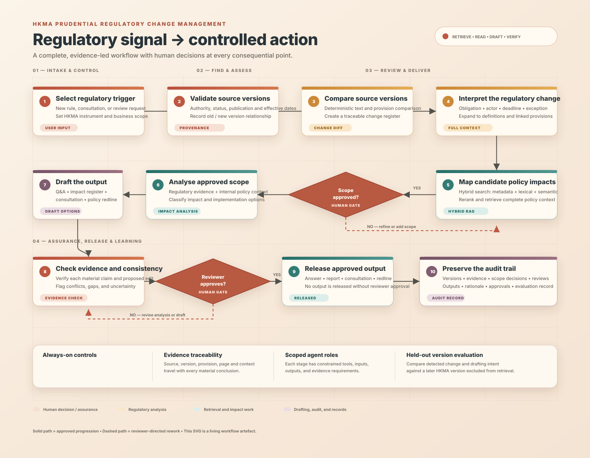
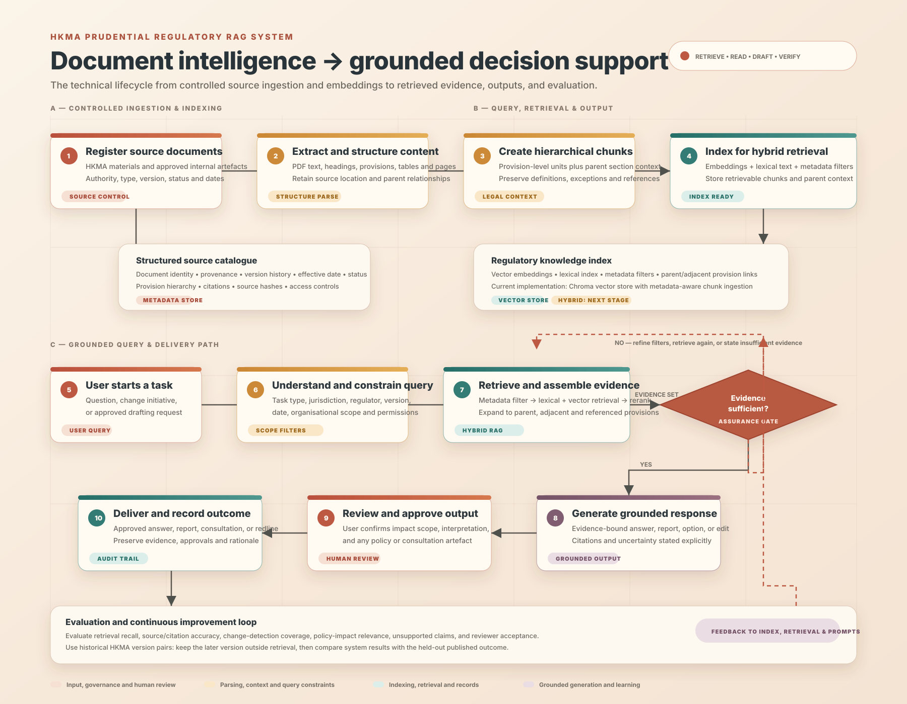

# Multi-Agent RAG System for Regulatory Policy Change Management

This repository is a controlled prototype for regulatory change management, starting with HKMA prudential supervisory materials. Its design principle is:

> **Retrieve broadly; read precisely; draft conservatively; verify explicitly.**

## System workflow

[](docs/hkma-regulatory-change-workflow.svg)

The editable [system workflow diagram](docs/hkma-regulatory-change-workflow.svg) is the living visual architecture for this project. It shows the complete intended workflow, mandatory human review gates, rework loops, release, and audit trail.

### RAG system workflow

[](docs/hkma-rag-system-workflow.svg)

The editable [RAG system workflow diagram](docs/hkma-rag-system-workflow.svg) shows the technical lifecycle: controlled ingestion, structured chunks and embeddings, the knowledge index, hybrid retrieval, grounded generation, output approval, and evaluation feedback.

The project has two deliberately separated foundations:

- **Cited RAG:** index selected PDFs in ChromaDB using OpenAI embeddings and answer questions with source/page citations.
- **Controlled change workflow:** compare two selected PDF versions deterministically, then require a human reviewer to approve or supplement the internal-document scope before any future drafting step.

It does **not** yet identify candidate internal policies automatically, use hybrid retrieval, generate amendment wording, produce Word tracked changes, or implement independent LLM agents. Those are subsequent stages described in the [project blueprint](PROJECT_BLUEPRINT.md).

## Project layout

```text
regulatory-multiagent-rag/
├── data/
│   └── pdfs/                 # Put source PDFs here (subfolders are supported)
├── src/
│   └── regulatory_rag/
│       ├── __init__.py
│       ├── cli.py             # Ingest and interactive/query command-line interface
│       ├── config.py          # Environment and project settings
│       ├── ingestion.py       # PDF loading, chunking, and Chroma indexing
│       ├── query.py           # Retrieval, answer generation, and citations
│       ├── metadata.py        # Validated source/version metadata registry
│       ├── change_workflow.py # Deterministic comparison and review-scope records
│       └── vector_store.py    # OpenAI embeddings and ChromaDB construction
├── data/
│   └── document_metadata.example.json
├── .env.example               # Copy to .env and add your OpenAI API key
├── .gitignore
└── pyproject.toml             # Package metadata and dependencies
```

## Setup in VS Code on Windows

Open this folder in VS Code, then run the following commands in a PowerShell terminal:

```powershell
py -3.10 -m venv .venv
.\.venv\Scripts\Activate.ps1
python -m pip install --upgrade pip
python -m pip install -e .
Copy-Item .env.example .env
```

Open `.env` and set `OPENAI_API_KEY` to your API key. Do not commit `.env`. Place the PDFs you want to search in `data/pdfs/`; nested folders are searched too.

## HKMA pilot corpus and metadata

Use a small, permitted set of HKMA prudential materials for the first pilot. Record the authoritative PDF version and its provenance before indexing it. Copy `data/document_metadata.example.json` to `data/document_metadata.json`, then replace the example entry with the actual files and information.

The `source` value must be the PDF path relative to `data/pdfs/`, for example `hkma/CA-G-5-v1.pdf`. Required fields are:

- `source`, `document_id`, `title`, `jurisdiction`, `regulator`, `document_type`, and `version`.

Optional fields are:

- `publication_date`, `effective_date`, `status`, and `superseded_by`.

The metadata is validated at ingestion and stored with each indexed chunk. The current retrieval command does not yet expose metadata filters; adding filterable hybrid retrieval is the next RAG enhancement.

## Use

Build or refresh the local ChromaDB index:

```powershell
python -m regulatory_rag.cli ingest
```

Ask one question:

```powershell
python -m regulatory_rag.cli ask "What are the main reporting obligations?"
```

Run `ask` without a question to enter interactive mode; type `exit` or `quit` to stop. Answers include numbered citations, followed by each cited PDF path and page number. Re-running `ingest` refreshes the collection from the PDFs currently in `data/pdfs/`.

### Compare selected regulatory versions

Create a repeatable, page-level text comparison from two authoritative PDFs:

```powershell
python -m regulatory_rag.cli compare data/pdfs/hkma/CA-G-5-v1.pdf data/pdfs/hkma/CA-G-5-v2.pdf
```

The command saves a machine-readable report under `data/change_reports/`. It is a deterministic extraction and diff—not a legal interpretation—and should be checked against the source PDFs, including tables, footnotes, and scanned pages.

### Approve the drafting scope

After candidate internal documents have been identified, require a reviewer to confirm them before a later drafting workflow:

```powershell
python -m regulatory_rag.cli review-scope data/change_reports/CA-G-5-v1--CA-G-5-v2.json `
  --candidate internal-policies/outsourcing-policy.docx `
  --candidate internal-policies/operational-risk-procedure.docx
```

The command asks the reviewer to include or exclude each candidate, accepts additional documents, and writes the decision under `data/scope_decisions/`. These folders are ignored by Git because reports may include controlled documents or analysis.

The `.env` file supports optional `OPENAI_CHAT_MODEL`, `OPENAI_EMBEDDING_MODEL`, `CHROMA_COLLECTION`, `CHROMA_DIRECTORY`, `PDF_DIRECTORY`, `DOCUMENT_METADATA_FILE`, `CHUNK_SIZE`, `CHUNK_OVERLAP`, and `RETRIEVAL_K` settings. Paths may be absolute or relative to the project root.
